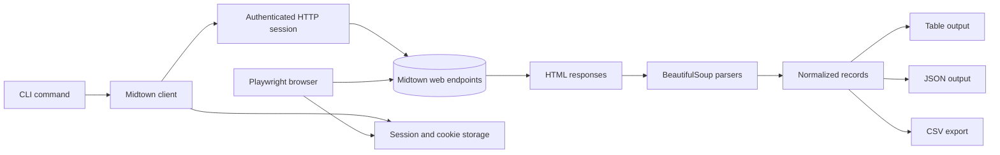
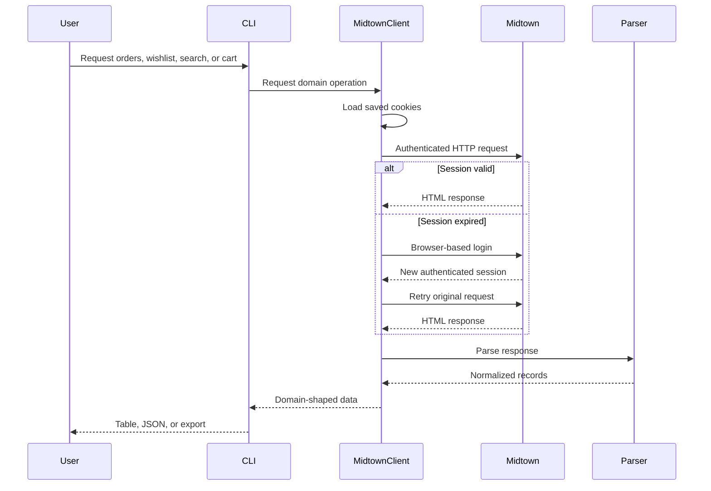

# Midtown Comics CLI — Technical Architecture

## Architectural style

The CLI is a layered read-through client. It requests pages or endpoint responses from Midtown, parses the returned HTML, normalizes the result into Python dictionaries, and presents the records through Click commands.

## Components

### CLI layer

The CLI layer defines command groups, options, date and month filters, output modes, exports, and user-facing error handling. It is responsible for deciding how records are displayed, not for interpreting Midtown HTML directly.

The main command areas are authentication, orders, comics, preorders, cart, wishlist, search, account, and help.

### Client layer

The client owns the HTTP session and the conceptual Midtown operations. It loads compatible session cookies, calls the required account or catalog endpoints, detects expired authentication, invokes login when necessary, and retries the original read once authenticated.

It also coordinates multi-request operations such as order details, preorder release dates, and lazy-loaded search product bodies.

### Parser layer

Parsers convert HTML pages into normalized records. They isolate Midtown markup assumptions from the client and CLI layers. The parser boundary is important because the external site may change selectors, table structures, labels, or lazy-loading behavior without changing the domain meaning of an order or product.

### Authentication layer

The authentication boundary uses Playwright because Midtown's login requires browser JavaScript and a reCAPTCHA v3 token. Automated login uses a persistent headless browser profile. Manual login can expose a temporary remote browser through Xvfb, x11vnc, noVNC, and ngrok when the automated path is insufficient.

### Local session state

Session cookies, imported cookies, and the browser profile are stored in the configured user directory, normally `~/.config/midtown-comics`. They are not part of the application's domain data and should not be committed or exported.

### Test layer

Tests use inline HTML fixtures and local fake objects. They verify parser behavior, cookie filtering, authentication signals, and CLI contracts without making live network requests.

## Information flow

## External endpoint categories

- **Account endpoints** — orders, account profile, wishlist, and previews/preorder data.
- **Order detail endpoints** — item-level data for a specific order.
- **Cart endpoint** — quick-cart contents and totals.
- **Search endpoints** — catalog result pages and lazy-loaded product bodies.
- **Product endpoints** — release-date enrichment for preorder items.
- **Login endpoint and browser page** — authentication and session establishment.

The endpoint paths are implementation details of the integration boundary; the domain documentation treats them as sources of specific record types.

## Design rationale

The project keeps external-site interpretation in parsers, account communication in the client, and presentation in the CLI. This separation limits the impact of Midtown markup changes, supports JSON/CSV output without duplicating retrieval logic, and enables tests that do not require credentials or network access.

The absence of a local database is deliberate: the CLI is a query and export tool, while Midtown owns the account state. Local session state is operational infrastructure, not a second catalog or purchase ledger.
