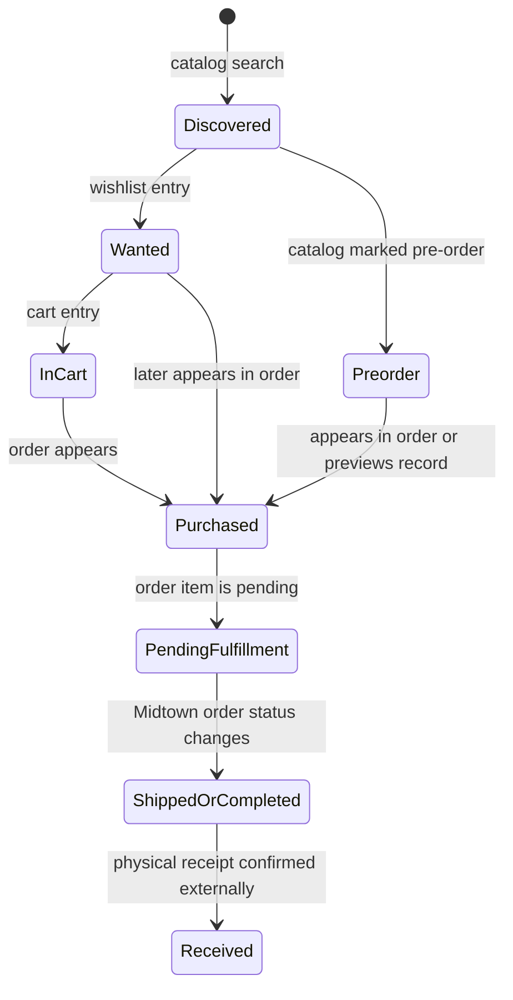

# Midtown Comics CLI — Acquisition Lifecycle

## Purpose

The CLI observes several stages of a comic acquisition journey. These stages come from different Midtown account and catalog views, so they must not be collapsed into a single ownership status.

The CLI can observe the first several states but does not independently verify physical receipt or collection ownership.

## Discovery

A comic enters the CLI's observable universe through catalog search. Search returns a point-in-time product observation with title, publisher, price, release date, availability, product identifier, and URL.

Search visibility is controlled by the website's filters:

- Regular results may omit preorders.
- Out-of-stock products may be hidden.
- Explicit options include those product classes.
- Some product cards require an additional lazy-loaded request to complete price or availability.

## Wishlist

A wishlist item represents user interest or an acquisition target. It is not a purchase and does not prove availability. The CLI reads the current title, product identifier, URL, and displayed price.

Prices in the wishlist are snapshots and can differ from the price at purchase time.

## Cart

The cart represents items currently staged for possible checkout. The CLI reads quantity, title, unit price, subtotal, cart total, and free-shipping threshold information when available.

The cart is explicitly read-only. Its presence does not mean that a purchase has been placed, charged, or reserved.

## Purchased order

A comic becomes observable as purchased when it appears as an item in an order. The order supplies the purchase context: number, date, status, total, and source account.

An order may be in process or processed/shipped/completed according to the information exposed by Midtown. These labels describe Midtown's order state, not an independently verified physical ownership state.

## Preorders

The CLI combines two preorder sources:

1. Pending items inside regular orders, enriched with release dates from product pages.
2. Midtown Previews items from the dedicated preorder section.

The combined record keeps a `source` field so that an order-based preorder remains distinguishable from a Previews preorder.

## Fulfillment and receipt

The CLI can observe status labels such as pending, shipped, or completed when Midtown exposes them. It cannot prove that the user physically received a comic. Receipt and collection ownership therefore belong to a downstream collection system or explicit user confirmation.

This distinction is important when integrating Midtown data into LongBox: an external order item can be used as acquisition evidence, but it should not automatically overwrite the physical collection state.

## Duplicate purchases

The CLI can identify comics bought in more than one order using product identity and order context. A duplicate purchase may represent:

- Multiple copies intentionally purchased.
- The same product ordered more than once.
- A repeated order caused by a correction or replacement.
- A product identity that does not fully distinguish edition or variant.

Duplicate detection is therefore an observation for review, not proof of an error.

## Recommended mapping into a collection system

- Search result → candidate catalog item.
- Wishlist item → desired or planned acquisition.
- Cart item → temporary purchase intent.
- Order item → recorded purchase.
- Pending order item → purchase awaiting fulfillment.
- Shipped/completed order item → external fulfillment evidence.
- Physical receipt → must be confirmed outside this CLI.

The CLI should remain read-only and should not be treated as the authoritative collection inventory.
