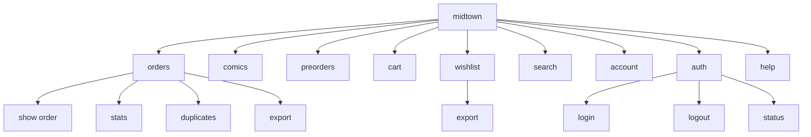

# Midtown Comics CLI — Command and Output Model

## Command map

## Account and authentication commands

### `auth login`

Establishes or refreshes the local Midtown session. The normal path uses stored credentials and a headless browser. The remote option supports manual browser login when automation cannot complete authentication.

### `auth logout`

Removes the saved session and browser profile so the next account query must authenticate again.

### `auth status`

Reports the existence and location of credential/session files without exposing their contents.

## Order commands

### `orders`

Returns order summaries with date, order number, status, comics, total, and currency. It may retrieve item details for each order.

### `orders show <number>`

Returns one order and its item details without retrieving every order's detail.

### `orders stats`

Aggregates order count, comic count, total spent, distinct products, and status breakdown. Optional cart inclusion adds current cart values but does not convert cart contents into purchases.

### `orders duplicates`

Identifies products observed in more than one order. The result is a review list, not an automatic correction.

### `orders export`

Writes order summaries to JSON or CSV. The export is a snapshot and should be handled as potentially confidential account data.

## Catalog and planning commands

### `comics`

Lists comics purchased through the account, with optional date and month filters.

### `preorders`

Combines regular-order pending items with Midtown Previews preorder items. It includes quantities, prices, release dates, source, order context, and status.

### `wishlist`

Lists current wishlist items and displayed prices. The export subcommand writes JSON or CSV.

### `cart`

Reads the quick-cart state. It is a read-only observation of temporary checkout intent.

### `search <text>`

Searches the Midtown catalog. Optional flags include preorders, out-of-stock products, page size, and page number. Search records include product identity, title, publisher, price, availability, release date, and URL where available.

### `account`

Returns the selected profile fields exposed by Midtown's account page.

## Cross-cutting output modes

### Human-readable mode

Lists and tables are formatted for terminal reading. Numeric prices are rendered in USD with two decimal places where available.

### JSON mode

`--json` produces machine-readable records containing the fields returned by the client. It can be placed before or after a command according to the CLI contract.

### CSV export

CSV exports are intentionally flatter than JSON. They are suitable for spreadsheets and downstream imports but may omit nested item details or fields that do not fit the selected export schema.

## Filtering model

Order and comic queries support:

- Inclusive lower date boundary.
- Inclusive upper date boundary.
- Month summary mode.
- A specific `YYYY-MM` month selection.

The filters affect the retrieved or aggregated view; they do not change Midtown account data.

## Output semantics

- Empty output means no matching records or no data exposed by the source.
- A missing price means Midtown did not expose a parseable price in that response.
- A missing availability means the page did not expose a recognized state.
- A product URL is a navigation reference, not proof of stock or ownership.
- Totals reflect the values returned by Midtown and may exclude shipping, tax, or cart charges depending on the command.
